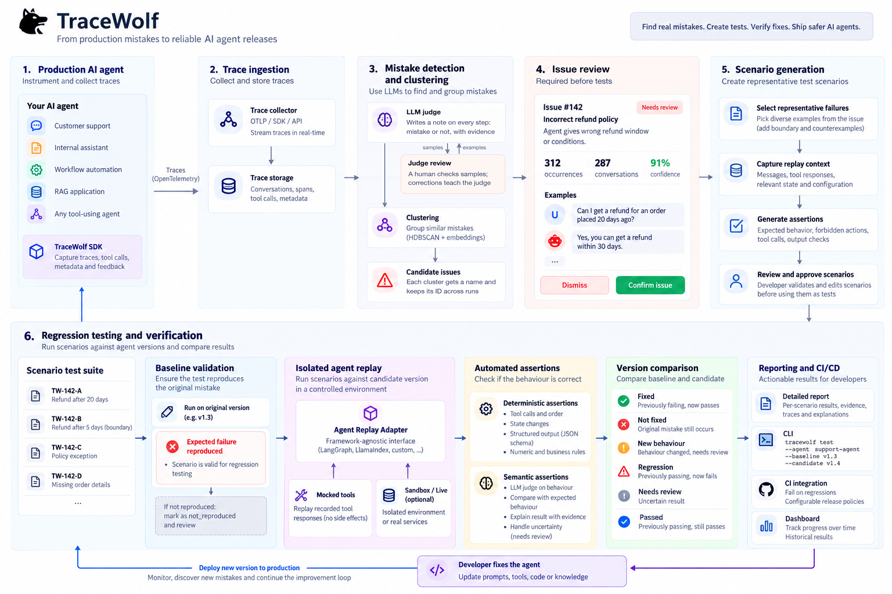
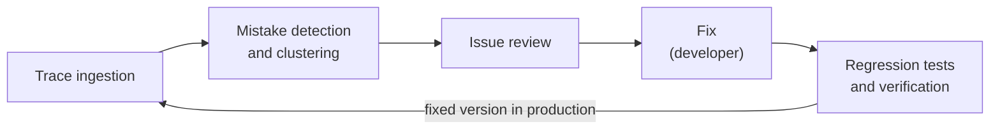

# TraceWolf

TraceWolf finds the mistakes your tool-using AI agent makes in production, has a human confirm them, and proves your fix on the exact moments the agent failed.

  

## The problem

Teams that run a tool-using agent in production (an agent that searches products, books, refunds…) find its mistakes by reading conversations by hand. When they change the prompt or the code, they can't prove the fix works before shipping it: they ship and watch.

## How it works

- **Trace ingestion:** the SDK captures every LLM call and tool call of each conversation.
- **Mistake detection and clustering:** an LLM judge writes a note on every step, and similar notes are grouped into issues.
- **Issue review:** the team keeps or dismisses each new issue; only kept issues become tests.
- **Regression tests and verification:** each kept issue becomes scenarios that stop just before the mistake. The fixed agent runs on them with one command, and each comes back `fixed`, `not_fixed` or `new_behavior`.
- **Judge tuning** (beside the loop): humans check samples of the judge's notes, and their corrections make it better.

## Documents

- [TraceWolf Design Paper](docs/trace-wolf-design-paper.md): the goal and the loop, with links to each step.
- [Trace ingestion](docs/trace-ingestion.md)
- [Mistake detection and clustering](docs/mistake-detection-and-clustering.md)
- [Issue review](docs/issue-review.md)
- [Regression tests and verification](docs/regression-tests.md)
- [Judge tuning](docs/judge-tuning.md)

