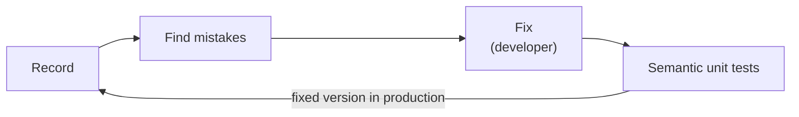

# TraceWolf

TraceWolf finds the mistakes your tool-using AI agent makes in production, has a human confirm them, and proves your fix on the exact moments the agent failed.

## The problem

Teams that run a tool-using agent in production (an agent that searches products, books, refunds…) find its mistakes by reading conversations by hand. When they change the prompt or the code, they can't prove the fix works before shipping it: they ship and watch.

## How it works

- **Record:** the SDK captures every LLM call and tool call of each conversation.
- **Find mistakes:** an LLM judge writes a note on every step, similar notes are grouped into issues, and a human keeps or dismisses each issue.
- **Semantic unit tests:** each issue becomes scenarios that stop just before the mistake. The fixed agent runs on them with one command, and each comes back `fixed`, `not_fixed` or `new_behavior`.

## Documents

- [TraceWolf Design Paper](docs/trace-wolf-design-paper.md): the full design.

