# Deep Evaluation White Paper

**Author:** g.askri@instadeep.com | **Status:** Draft | **Last updated:** 18 Oct 2026

## Goal

Deep Evaluation is a loop that finds the mistakes a tool-using agent makes in production, turns them into tests, and proves each fix on real conversations without touching real systems.

It is a chain of three steps, with the developer's fix between Find mistakes and Semantic unit tests. Each step uses what the step before produced and hands its result to the step after. Once the fixed version is in production, it is recorded and the loop starts again.

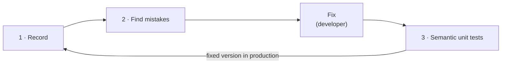

---

## 1. Record

The customer adds the **Wolf SDK** to their agent app. Record collects the **conversations**, as traces and spans: everything the agent did, turn by turn, with every LLM call and every tool call in full.

Every later step is built on them. If a tool result is missing, **[Find mistakes](#2-find-mistakes)** can't see that the agent contradicted it.

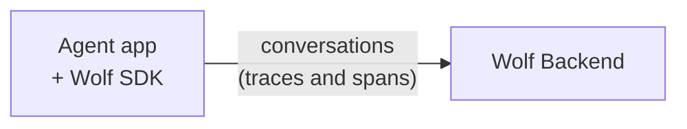

---

## 2. Find mistakes

Find mistakes is an automated version of the error analysis experts do by hand, in three phases. It reads the conversations collected by **[Record](#1-record)**, writes a note on every step saying whether it went wrong and why, groups the notes into **issues**, and tracks those issues over time. **[Semantic unit tests](#3-semantic-unit-tests)** then turns its conversations into tests.

A mistake is judged only from what the agent did, never from whether the user bought.

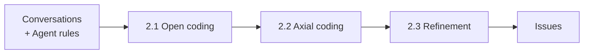

### 2.1 Open coding

In open coding, an **LLMJ** (LLM as a judge) takes notes on **each step** of the conversation: every LLM call and every tool call, not the full run at once. The user's messages are read as context but not judged. The LLMJ works in a chain, and humans keep it honest:

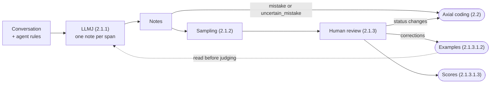

#### 2.1.1 LLMJ

The LLMJ does annotation work: it reads each span and writes a note on it, one note per span. The status is one of three values:

```
Status = "mistake" | "not_mistake" | "uncertain_mistake"
```

Each note contains an **id**, a **status** and **evidence**:

```jsonc
{
  "id": string,
  "span_id": string,
  "status": Status,
  "evidence": string | null  // null when not_mistake
}
```

The evidence is a plain English sentence.

#### 2.1.2 Sampling

The LLMJ writes too many notes for humans to check them all, so we prepare three samples, each a list of notes:

```
UncertainSample = [Note]    // notes where status = "uncertain_mistake"
AccuracySample  = [Note]    // random notes where status = "mistake" or "uncertain_mistake"
RecallSample    = [[Note]]  // random conversations, each the list of its notes, where every status = "not_mistake"
```

Each sample has its own purpose: the Uncertain sample settles the notes the LLMJ doubted, the Accuracy sample measures how often its notes are right, and the Recall sample looks for mistakes it missed.

#### 2.1.3 Human review

A human answers for each note in the samples, and each answer is sent to its destinations ([2.1.3.1](#2131-destinations)). Sections [2.1.3.2](#2132-uncertain-sample-review) to [2.1.3.4](#2134-recall-sample-review) show this routing for each sample. Whole issues are reviewed later, in refinement ([2.3.3](#233-issue-human-review)).

##### 2.1.3.1 Destinations

For each note in a sample, the human answers whether it is a real mistake. The answer is then sent to up to three destinations: axial coding, examples and scores.

###### 2.1.3.1.1 Axial coding

Axial coding receives notes ([2.1.1](#211-llmj)), not answers. It clusters every note whose **final status** (the human's status if a human checked the note, otherwise the LLMJ's) is `mistake` or `uncertain_mistake` ([2.2](#22-axial-coding)).

###### 2.1.3.1.2 Examples

Human corrections the LLMJ reads before judging new spans. An example is created when the human answer differs from the LLMJ's status, or when the evidence is wrong:

```
Examples = [Example]
```

```jsonc
// Example
{
  "note_id": string,                 // the note the human checked
  "llmj_status": Status,
  "human_status": Status,
  "evidence_right": boolean | null,  // Accuracy sample only
  "human_evidence": string | null    // Recall sample only
}
```

###### 2.1.3.1.3 Scores

Reliability measures of the LLMJ, computed from the Accuracy and Recall samples. Each score counts right and wrong answers; its value is right ÷ (right + wrong):

```
ScoreType = "precision_score" | "evidence_score" | "miss_score"
```

```
Scores = [Score]
```

```jsonc
// Score
{
  "type": ScoreType,
  "right": int,
  "wrong": int   // for miss_score: conversations with a missed mistake
}
```

##### 2.1.3.2 Uncertain sample review

Notes where status = `uncertain_mistake`. The human decides whether each one is a real mistake.

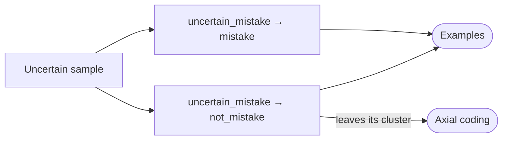

##### 2.1.3.3 Accuracy sample review

Random notes where status = `mistake` or `uncertain_mistake`. The human decides whether each one is a real mistake and, if so, whether its evidence is right.

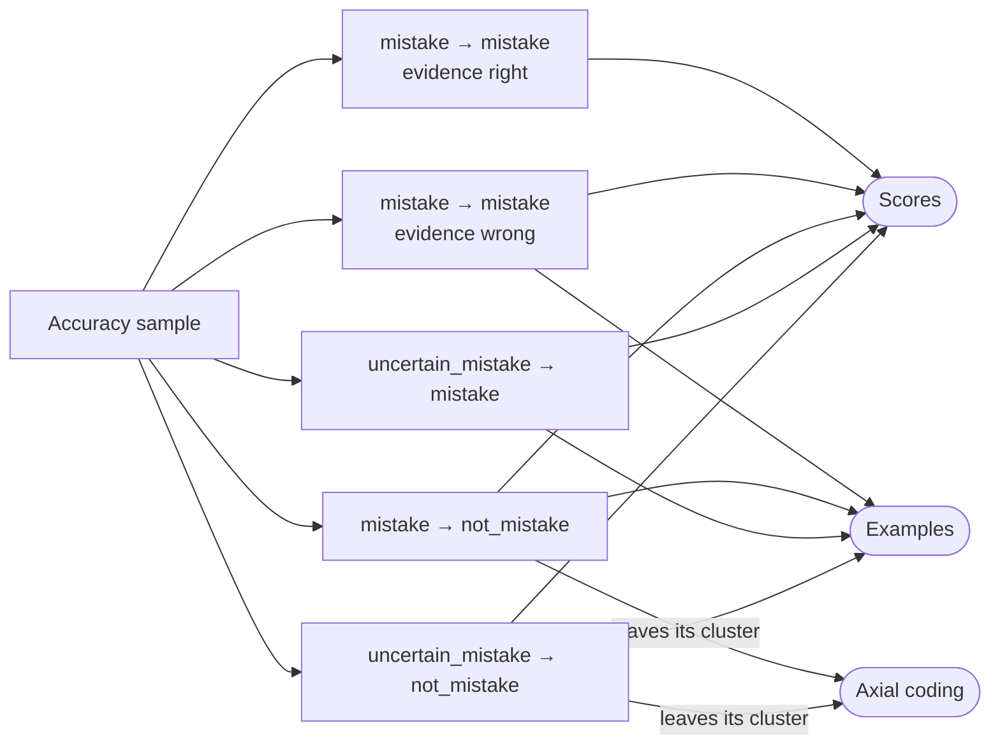

##### 2.1.3.4 Recall sample review

Random conversations where all notes = `not_mistake`. The human looks for a missed mistake; if there is one, they mark that span's note as `mistake` and write its evidence.

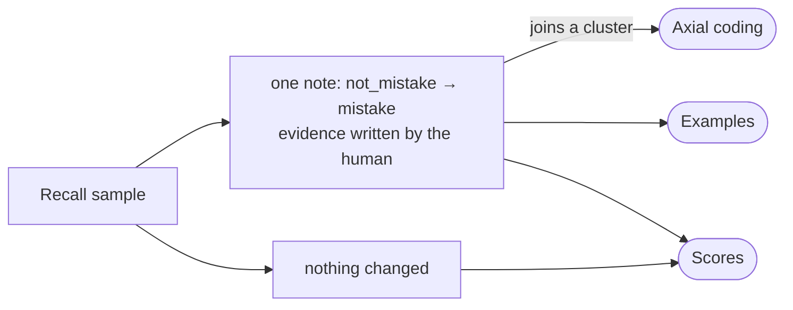

### 2.2 Axial coding

Axial coding groups similar notes into **clusters**: each cluster is one kind of mistake the agent makes. It receives the notes whose final status is `mistake` or `uncertain_mistake` ([2.1.3.1.1](#21311-axial-coding)) and compares their evidence only, so notes that describe the same mistake end up together, whatever the conversation. Clusters have no name yet: refinement names them ([2.3](#23-refinement)).

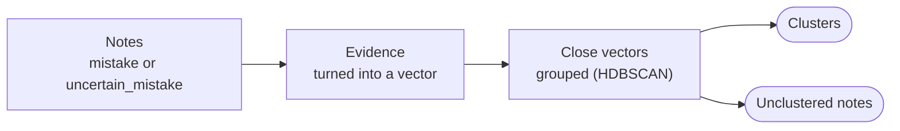

**Algorithm.** Each note's evidence is turned into a vector, and **HDBSCAN** groups close vectors, with at least 5 notes per cluster. It finds the number of clusters on its own, and leaves isolated notes out as unclustered instead of forcing them in.

**Periodic run.** Clustering runs again periodically (e.g. weekly, or once a new agent version has enough notes). Refinement then matches the new clusters to the existing issues ([2.3.1](#231-hungarian-matching)).

**Unclustered notes.**

1. HDBSCAN marks notes with no close neighbours as unclustered.
2. At each clustering run, they're clustered again together with all the other notes.
3. Once 5 similar notes have gathered, they form a new cluster, which is a new kind of mistake.
4. A note still alone after a while (e.g. 4 weeks) leaves the list. It stays in the database; it just stops being shown.

### 2.3 Refinement

Refinement turns **clusters** into **issues**. An issue is a cluster with an ID, a name, a description and a history: it is what the team reads and fixes.

```jsonc
// Issue
{
  "id": string,
  "name": string,
  "description": string,
  "note_ids": [string],                            // ids of the notes of its cluster
  "named_by_user": boolean,                        // true: the name is never rewritten
  "dismissed": boolean,                            // true: marked not a mistake
  "history": [Event]                               // what happened to the issue, in date order
}
```

```
EventName = "created" | "renamed" | "notes_removed" | "split" | "merged" | "dismissed" | "no_longer_seen"
```

```jsonc
// Event
{
  "date": string,
  "name": EventName,
  "description": string   // e.g. "split from I-1", "renamed by user: Budget filter bug"
}
```

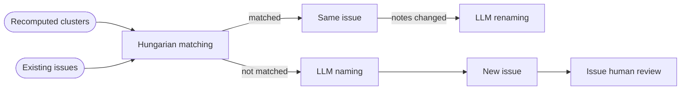

**Counting.** An issue counts **conversations**, not notes, and only notes whose final status is `mistake` or `uncertain_mistake` ([2.1.3.1.1](#21311-axial-coding)). Three notes from the same conversation count once.

#### 2.3.1 Hungarian matching

Each periodic run of axial coding recomputes the clusters from scratch ([2.2](#22-axial-coding)): these **recomputed clusters** have no identity yet. Hungarian matching pairs each recomputed cluster with the existing issue it shares the most notes with, at most one cluster per issue. A matched cluster keeps the issue's ID and history; a cluster with no match becomes a new issue. An issue that splits or merges is renamed ([2.3.2](#232-llm-naming-and-renaming)).

More on the algorithm: [Hungarian algorithm](https://en.wikipedia.org/wiki/Hungarian_algorithm) (Wikipedia), and its SciPy implementation, [`linear_sum_assignment`](https://docs.scipy.org/doc/scipy/reference/generated/scipy.optimize.linear_sum_assignment.html).

#### 2.3.2 LLM naming and renaming

An LLM reads up to 15 notes of an issue and writes its name and description.

- **Naming:** a new issue gets its name when it is created.
- **Renaming:** an existing issue is renamed when its notes change:
  - **split:** it lost part of its notes to a new issue, so its name may be too broad;
  - **merge:** it absorbed another issue, so its name must cover both;
  - **periodic** (e.g. every two weeks): even without a split or a merge, new notes join and old ones leave, so the name can drift away from what the notes now say.

A name a user wrote is never rewritten.

#### 2.3.3 Issue human review

Human review checks single notes ([2.1.3](#213-human-review)); the issue human review checks whole issues. A new issue can be made of wrong notes: for example, 40 notes say "the agent searched before asking the shoe size", but the rules don't require asking first. So after each run, the team reads the 5 most typical notes of each new issue. Like any human answer, wrong notes become examples for the LLMJ ([2.1.3.1.2](#21312-examples)).

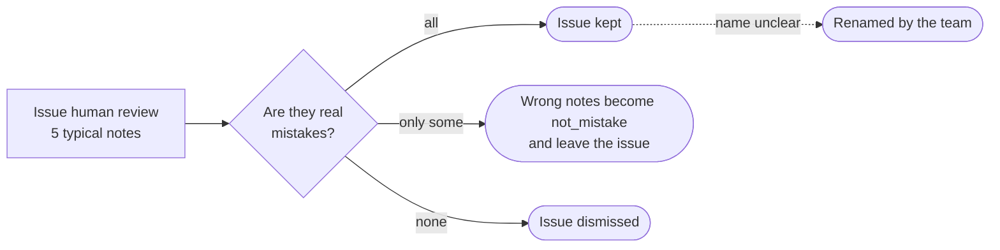

**Renaming.** If the notes are right but the LLM's name is unclear, the team renames the issue. This sets `named_by_user` to true, so LLM renaming ([2.3.2](#232-llm-naming-and-renaming)) never rewrites it, and adds a `renamed` event to its history. The team can also rename any issue at any time.

**Dismissed issues.** The team can dismiss any issue as *not a mistake*. Its conversations leave the counts, its notes become `not_mistake` and examples for the LLMJ, and new notes that join it are hidden. It keeps its ID, so the next matching recognises it instead of creating it again.

---

## 3. Semantic unit tests

**Semantic unit tests turn each issue into scenarios, execute them on the developer's new agent version without touching production, and show which mistakes are fixed.**

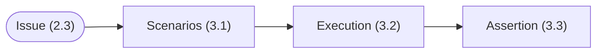

### 3.1 Scenarios

A scenario is the situation just before a mistake: what the agent read at that moment, including the tool answers it had received. An issue's notes are grouped by situation, and one scenario is kept per kind of situation: a fix can work in some situations and not in others.

```
Scenarios = [Scenario]   // one list per issue, one scenario per kind of situation
```

```jsonc
// Scenario
{
  "id": string,
  "issue_id": string,
  "note_id": string,              // the original mistake
  "messages": [Message]           // what the agent read just before the mistake
}
```

Wolf writes the scenarios from the issue's notes.

### 3.2 Execution

The developer changes the agent (its prompt, its code or its model) and runs the scenarios, on their computer or in their CI, with one command. Each scenario is given to the fixed agent, which answers the scenario's last user message; that answer goes to the assertion.

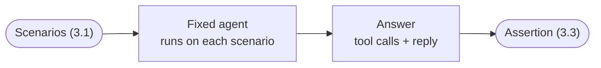

### 3.3 Assertion

The LLMJ compares the fix with the original mistake: *did the new agent make the same mistake?*

```
TestResult = "fixed" | "not_fixed" | "new_behavior"
```

| Result | Definition |
|---|---|
| **fixed** | The answer no longer makes the mistake |
| **not_fixed** | The answer makes the same mistake again |
| **new_behavior** | The answer no longer makes the mistake, but does something new that looks wrong, e.g. a different mistake, to be checked by the developer |
