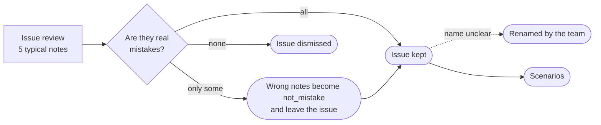

# Issue review

Part of the [TraceWolf design](trace-wolf-design-paper.md). Previous: [Mistake detection and clustering](mistake-detection-and-clustering.md). Next: [Regression tests and verification](regression-tests.md).

Issue review checks the whole issues that **[Mistake detection and clustering](mistake-detection-and-clustering.md)** produces, and only the issues it keeps become scenarios in **[Regression tests and verification](regression-tests.md#1-scenarios)**. Single notes are checked separately, in **[Judge tuning](judge-tuning.md#2-judge-review)**.

A new issue can be made of wrong notes: for example, 40 notes say "the agent searched before asking the shoe size", but the rules don't require asking first. So after each run, the team reads the 5 most typical notes of each new issue. Like any human answer, wrong notes become examples for the LLMJ ([Judge tuning](judge-tuning.md#3-examples)).

**Renaming.** If the notes are right but the LLM's name is unclear, the team renames the issue. This sets `named_by_user` to true, so LLM renaming ([Mistake detection and clustering](mistake-detection-and-clustering.md#32-llm-naming-and-renaming)) never rewrites it, and adds a `renamed` event to its history. The team can also rename any issue at any time.

**Dismissed issues.** The team can dismiss any issue as *not a mistake*. Its conversations leave the counts, its notes become `not_mistake` and examples for the LLMJ, and new notes that join it are hidden. It keeps its ID, so the next matching recognises it instead of creating it again.
