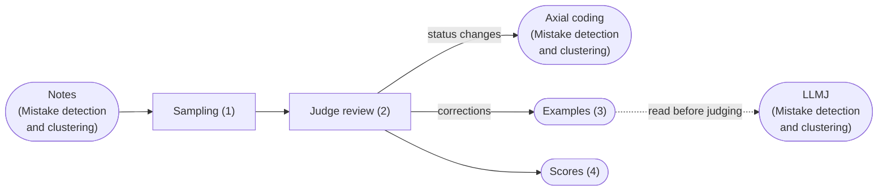
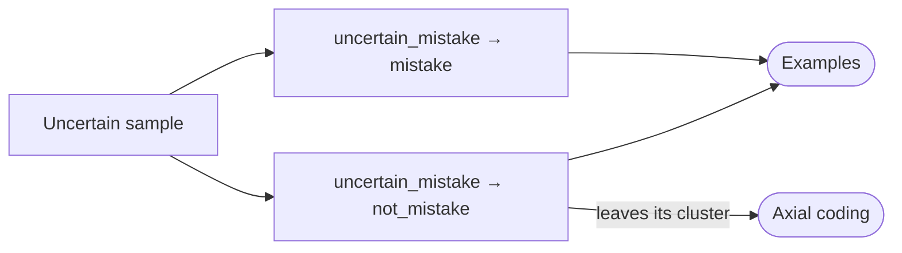
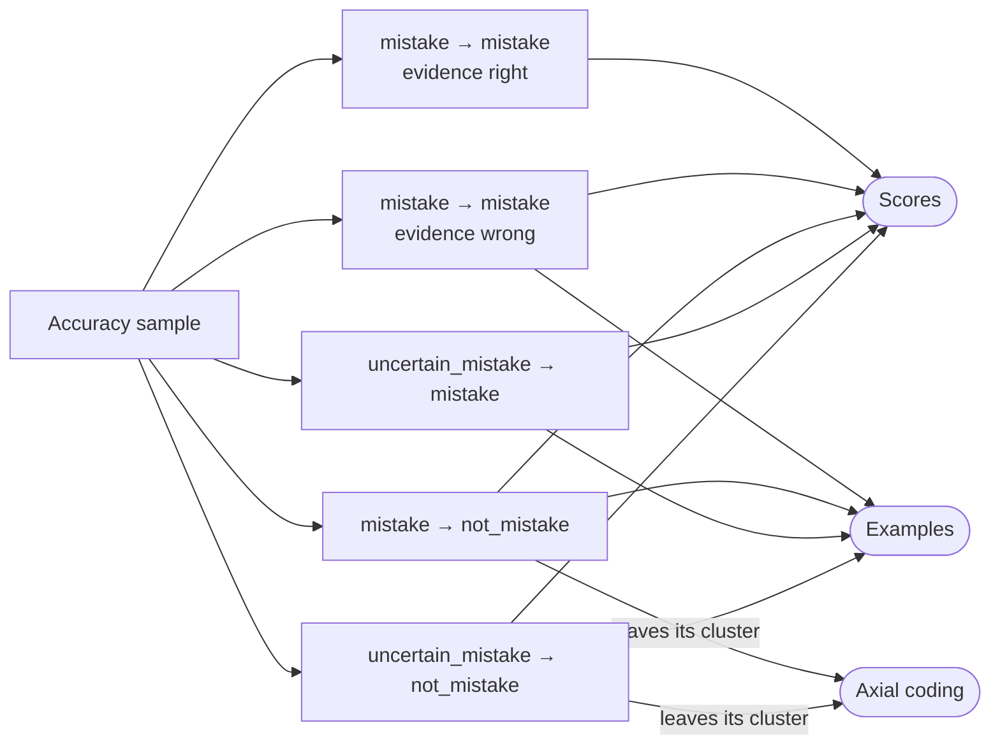
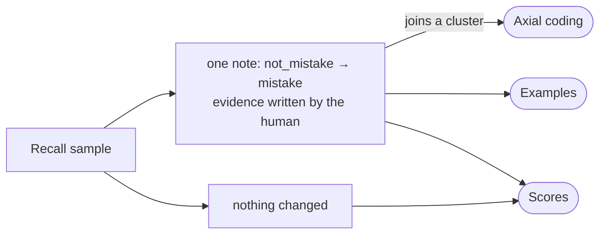

# Judge tuning

Part of the [TraceWolf design](trace-wolf-design-paper.md). Runs beside the loop and serves [Mistake detection and clustering](mistake-detection-and-clustering.md) and [Regression tests and verification](regression-tests.md).

Judge tuning checks the LLMJ and makes it better. The same LLMJ writes the notes in **[Mistake detection and clustering](mistake-detection-and-clustering.md)** and decides the test results in **[Regression tests and verification](regression-tests.md#3-assertion)**, so both depend on it. It runs beside the loop and never blocks it: a note no human checked keeps the LLMJ's status.



## 1. Sampling

The LLMJ writes too many notes for humans to check them all, so we prepare three samples, each a list of notes:

```
UncertainSample = [Note]    // notes where status = "uncertain_mistake"
AccuracySample  = [Note]    // random notes where status = "mistake" or "uncertain_mistake"
RecallSample    = [[Note]]  // random conversations, each the list of its notes, where every status = "not_mistake"
```

Each sample has its own purpose: the Uncertain sample settles the notes the LLMJ doubted, the Accuracy sample measures how often its notes are right, and the Recall sample looks for mistakes it missed.

## 2. Judge review

For each note in a sample, a human answers whether it is a real mistake. The answer is then sent to up to three destinations: axial coding, where a changed status moves the note out of its cluster or into one ([final status](mistake-detection-and-clustering.md#1-open-coding)), examples ([3](#3-examples)) and scores ([4](#4-scores)). Sections [2.1](#21-uncertain-sample-review) to [2.3](#23-recall-sample-review) show this routing for each sample. Whole issues are reviewed in **[Issue review](issue-review.md)**.

### 2.1 Uncertain sample review

Notes where status = `uncertain_mistake`. The human decides whether each one is a real mistake.



### 2.2 Accuracy sample review

Random notes where status = `mistake` or `uncertain_mistake`. The human decides whether each one is a real mistake and, if so, whether its evidence is right.



### 2.3 Recall sample review

Random conversations where all notes = `not_mistake`. The human looks for a missed mistake; if there is one, they mark that span's note as `mistake` and write its evidence.



## 3. Examples

Human corrections the LLMJ reads before judging new spans. An example is created when the human answer differs from the LLMJ's status, or when the evidence is wrong:

```
Examples = [Example]
```

```jsonc
// Example
{
  "note_id": string,                 // the note the human checked
  "llmj_status": Status,
  "human_status": Status,
  "evidence_right": boolean | null,  // Accuracy sample only
  "human_evidence": string | null    // Recall sample only
}
```

## 4. Scores

Reliability measures of the LLMJ, computed from the Accuracy and Recall samples. Each score counts right and wrong answers; its value is right ÷ (right + wrong):

```
ScoreType = "precision_score" | "evidence_score" | "miss_score"
```

```
Scores = [Score]
```

```jsonc
// Score
{
  "type": ScoreType,
  "right": int,
  "wrong": int   // for miss_score: conversations with a missed mistake
}
```
