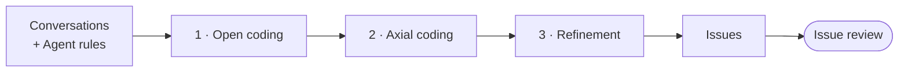
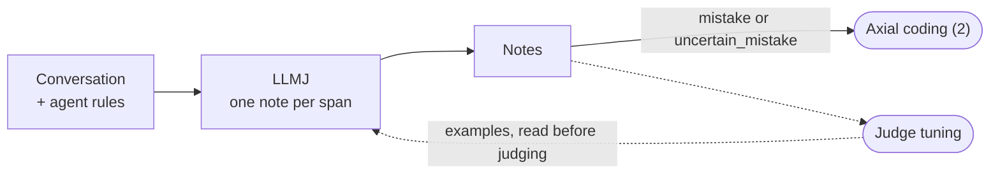
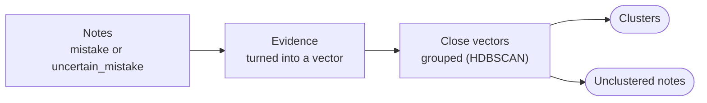
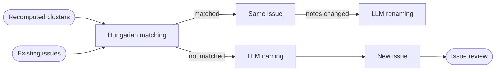

# Mistake detection and clustering

Part of the [TraceWolf design](trace-wolf-design-paper.md). Previous: [Trace ingestion](trace-ingestion.md). Next: [Issue review](issue-review.md).

Mistake detection and clustering is an automated version of the error analysis experts do by hand, in three phases. It reads the conversations collected by **[Trace ingestion](trace-ingestion.md)**, writes a note on every step saying whether it went wrong and why, groups the notes into **issues**, and tracks those issues over time. **[Issue review](issue-review.md)** then keeps or dismisses each new issue, and **[Regression tests and verification](regression-tests.md)** turns the kept ones into tests. The LLMJ it uses is checked and made better by **[Judge tuning](judge-tuning.md)**.

A mistake is judged only from what the agent did, never from whether the user bought.



## 1. Open coding

In open coding, an **LLMJ** (LLM as a judge) takes notes on **each step** of the conversation: every LLM call and every tool call, not the full run at once. The user's messages are read as context but not judged.



The LLMJ does annotation work: it reads each span and writes a note on it, one note per span. The status is one of three values:

```
Status = "mistake" | "not_mistake" | "uncertain_mistake"
```

Each note contains an **id**, a **status** and **evidence**:

```jsonc
{
  "id": string,
  "span_id": string,
  "status": Status,
  "evidence": string | null  // null when not_mistake
}
```

The evidence is a plain English sentence.

**Final status.** A note's final status is the human's status if a human checked it in **[Judge tuning](judge-tuning.md)**, otherwise the LLMJ's. Every note whose final status is `mistake` or `uncertain_mistake` goes to axial coding ([2](#2-axial-coding)).

## 2. Axial coding

Axial coding groups similar notes into **clusters**: each cluster is one kind of mistake the agent makes. It receives the notes whose final status is `mistake` or `uncertain_mistake` ([1](#1-open-coding)) and compares their evidence only, so notes that describe the same mistake end up together, whatever the conversation. Clusters have no name yet: refinement names them ([3](#3-refinement)).



**Algorithm.** Each note's evidence is turned into a vector, and **HDBSCAN** groups close vectors, with at least 5 notes per cluster. It finds the number of clusters on its own, and leaves isolated notes out as unclustered instead of forcing them in.

**Periodic run.** Clustering runs again periodically (e.g. weekly, or once a new agent version has enough notes). Refinement then matches the new clusters to the existing issues ([3.1](#31-hungarian-matching)).

**Unclustered notes.**

1. HDBSCAN marks notes with no close neighbours as unclustered.
2. At each clustering run, they're clustered again together with all the other notes.
3. Once 5 similar notes have gathered, they form a new cluster, which is a new kind of mistake.
4. A note still alone after a while (e.g. 4 weeks) leaves the list. It stays in the database; it just stops being shown.

## 3. Refinement

Refinement turns **clusters** into **issues**. An issue is a cluster with an ID, a name, a description and a history: it is what the team reads and fixes.

```jsonc
// Issue
{
  "id": string,
  "name": string,
  "description": string,
  "note_ids": [string],                            // ids of the notes of its cluster
  "named_by_user": boolean,                        // true: the name is never rewritten
  "dismissed": boolean,                            // true: marked not a mistake
  "history": [Event]                               // what happened to the issue, in date order
}
```

```
EventName = "created" | "renamed" | "notes_removed" | "split" | "merged" | "dismissed" | "no_longer_seen"
```

```jsonc
// Event
{
  "date": string,
  "name": EventName,
  "description": string   // e.g. "split from I-1", "renamed by user: Budget filter bug"
}
```



**Counting.** An issue counts **conversations**, not notes, and only notes whose final status is `mistake` or `uncertain_mistake` ([1](#1-open-coding)). Three notes from the same conversation count once.

### 3.1 Hungarian matching

Each periodic run of axial coding recomputes the clusters from scratch ([2](#2-axial-coding)): these **recomputed clusters** have no identity yet. Hungarian matching pairs each recomputed cluster with the existing issue it shares the most notes with, at most one cluster per issue. A matched cluster keeps the issue's ID and history; a cluster with no match becomes a new issue. An issue that splits or merges is renamed ([3.2](#32-llm-naming-and-renaming)).

More on the algorithm: [Hungarian algorithm](https://en.wikipedia.org/wiki/Hungarian_algorithm) (Wikipedia), and its SciPy implementation, [`linear_sum_assignment`](https://docs.scipy.org/doc/scipy/reference/generated/scipy.optimize.linear_sum_assignment.html).

### 3.2 LLM naming and renaming

An LLM reads up to 15 notes of an issue and writes its name and description.

- **Naming:** a new issue gets its name when it is created.
- **Renaming:** an existing issue is renamed when its notes change:
  - **split:** it lost part of its notes to a new issue, so its name may be too broad;
  - **merge:** it absorbed another issue, so its name must cover both;
  - **periodic** (e.g. every two weeks): even without a split or a merge, new notes join and old ones leave, so the name can drift away from what the notes now say.

A name a user wrote is never rewritten.
