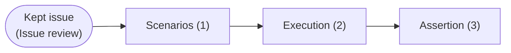
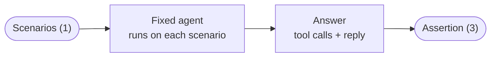

# Regression tests and verification

Part of the [TraceWolf design](trace-wolf-design-paper.md). Previous: [Issue review](issue-review.md).

**Regression tests and verification turn each kept issue into scenarios, execute them on the developer's new agent version without touching production, and show which mistakes are fixed.**



## 1. Scenarios

A scenario is the situation just before a mistake: what the agent read at that moment, including the tool answers it had received. An issue's notes are grouped by situation, and one scenario is kept per kind of situation: a fix can work in some situations and not in others.

```
Scenarios = [Scenario]   // one list per issue, one scenario per kind of situation
```

```jsonc
// Scenario
{
  "id": string,
  "issue_id": string,
  "note_id": string,              // the original mistake
  "messages": [Message]           // what the agent read just before the mistake
}
```

TraceWolf writes the scenarios from the issue's notes.

Only issues kept in **[Issue review](issue-review.md)** become scenarios: a scenario built from a wrong issue would push the developer to fix behavior that was correct. A new issue waits until the team has read its typical notes, and a dismissed issue never becomes scenarios. Once an issue is kept, notes that join it later can add scenarios without another review.

## 2. Execution

The developer changes the agent (its prompt, its code or its model) and runs the scenarios, on their computer or in their CI, with one command. Each scenario is given to the fixed agent, which answers the scenario's last user message; that answer goes to the assertion.



## 3. Assertion

The LLMJ (the LLM judge of **[Mistake detection and clustering](mistake-detection-and-clustering.md#1-open-coding)**) compares the fix with the original mistake: *did the new agent make the same mistake?*

```
TestResult = "fixed" | "not_fixed" | "new_behavior"
```

| Result | Definition |
|---|---|
| **fixed** | The answer no longer makes the mistake |
| **not_fixed** | The answer makes the same mistake again |
| **new_behavior** | The answer no longer makes the mistake, but does something new that looks wrong, e.g. a different mistake, to be checked by the developer |
