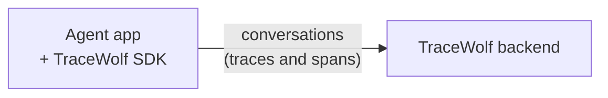

# Trace ingestion

Part of the [TraceWolf design](trace-wolf-design-paper.md). Next: [Mistake detection and clustering](mistake-detection-and-clustering.md).

The customer adds the **TraceWolf SDK** to their agent app. Trace ingestion collects the **conversations**, as traces and spans: everything the agent did, turn by turn, with every LLM call and every tool call in full.

Every later step is built on them. If a tool result is missing, **[Mistake detection and clustering](mistake-detection-and-clustering.md)** can't see that the agent contradicted it.

