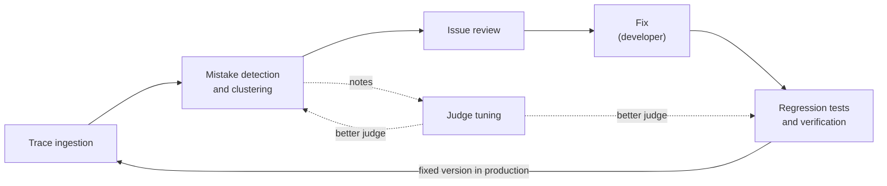

# TraceWolf Design Paper

**Author:** ghassen.askri@outlook.com | **Status:** Draft | **Last updated:** 28 Oct 2026;;

## Goal

TraceWolf is a loop that finds the mistakes a tool-using agent makes in production, has a human confirm them, turns them into tests, and proves each fix on the exact moments the agent failed, without touching production.

It is a chain of four steps, with the developer's fix between Issue review and Regression tests and verification. Each step uses what the step before produced and hands its result to the step after. Once the fixed version is in production, it is recorded and the loop starts again.

**Judge tuning** runs beside the loop. It checks the LLM judge used in two steps, Mistake detection and clustering, and Regression tests and verification, and makes it better without blocking anything.

## Documents

| Doc | What it covers |
|---|---|
| [Trace ingestion](trace-ingestion.md) | The SDK records every conversation, with each LLM call and tool call |
| [Mistake detection and clustering](mistake-detection-and-clustering.md) | An LLM judge writes a note on every step; similar notes are grouped into issues |
| [Issue review](issue-review.md) | The team keeps or dismisses each new issue; only kept issues become tests |
| [Regression tests and verification](regression-tests.md) | Kept issues become scenarios; the fixed agent runs on them and each comes back `fixed`, `not_fixed` or `new_behavior` |
| [Judge tuning](judge-tuning.md) | Humans check samples of the judge's notes; their corrections and scores make it better |
